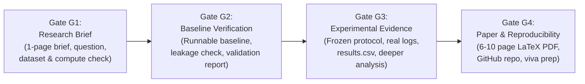

# Assignment Compliance Checklist & Specification Breakdown

**Course:** AI Tools for Research (AITR) — Lab 02 / Second Paper  
**Task:** Implementation-Based Research Study from Literature Review  
**Institution:** Department of Artificial Intelligence and Trustworthy Computing, IIIT Allahabad  
**Student:** Rajhans (Enrollment: PAI2026001, Email: pai2026001@iiita.ac.in)  
**Starting Review Paper:** *Token-Level Uncertainty as a Predictor of Hallucination in Large Language Models: A Structured Review*  
**Specification Source:** `atr_final_assignment.pdf` (11 pages)

---

## 1. Executive Summary of Assignment Mandate

The second paper requires conducting an evidence-based, reproducible, implementation-focused research project that naturally continues the literature review. The workflow follows the strict research trajectory:
$$\text{REVIEW} \rightarrow \text{VERIFIED GAP} \rightarrow \text{QUESTION} \rightarrow \text{BASELINE} \rightarrow \text{VALIDATION} \rightarrow \text{EXPERIMENT} \rightarrow \text{EVIDENCE} \rightarrow \text{PAPER} \rightarrow \text{REPRODUCE}$$

The student must act as the project director and intellectual owner, while AI serves strictly as a supervised research assistant and pair programmer. Course-level research quality and technical rigor are prioritized over speculative publication claims.

---

## 2. Core Research Standards & Rules of Engagement

| Standard | Assignment Requirement | Compliance Mechanism |
| :--- | :--- | :--- |
| **Continuity** | Remain squarely within the domain of the completed review (Token-Level Uncertainty & Hallucination Detection in LLMs). | Ground problem directly in Section 7 & Table 2 of review paper. |
| **Execution** | Produce working, runnable, and tested code. No mock-ups, screenshots, or unexecuted stubs. | Full Python codebase with automated unit tests and saved execution outputs. |
| **Evidence** | All numbers, tables, plots, and conclusions must derive from actual execution or explicitly attributed sources. | Results directly exported from scripts to CSVs, logs, and vector graphics. |
| **Comparison** | Include at least two appropriate baselines/comparators under identical experimental conditions. | Compare raw token UQ (negative log-prob / entropy) against sequence/claim-level or attention-aware methods. |
| **Depth** | Include at least one deeper analysis (ablation, error/failure cases, robustness, sensitivity, or resource efficiency). | Dedicated error analysis on high-certainty failure cases and compute-efficiency trade-offs. |
| **Reproducibility** | Full specification of data split, environment, hardware, seeds, hyperparameters, and rerun scripts. | Frozen `experiment.yaml`, deterministic seeds, `reproduce.sh`/PowerShell scripts. |
| **Ownership** | Student must understand every line of code, trace origins, validate AI suggestions, and defend in a viva. | Maintained AI assistance log, prompt-to-code diffs, and 30 technical viva questions. |
| **Integrity** | Never fabricate results, logs, citations, p-values, or AI mistakes. Disclose all AI assistance. | Tri-label evidence ledger: `[VERIFIED]`, `[INFERRED]`, `[UNKNOWN]`. |

---

## 3. Approved Pathways to a Contribution

The assignment explicitly sanctions four pathways:
- **Pathway A: Reproduction + Extension.** Reproduce a published method, then study a justified new condition or component. (Evidence: Validated baseline, extension comparison, explanation of discrepancies).
- **Pathway B: Controlled Comparative Study.** Evaluate relevant methods under a common, carefully chosen protocol answering a specific question. (Evidence: Fair controls, consistent metrics, informative failure or trade-off analysis).
- **Pathway C: Targeted Modification.** Change one technically justified component of a baseline. (Evidence: Baseline preserved, isolated change, ablation or controlled test).
- **Pathway D: Hybrid/Prototype + Evaluation.** Combine methods or build a prototype to investigate a computational hypothesis. (Evidence: Motivation for design, baselines, and rigorous evaluation).

---

## 4. Four Milestones and Approval Gates

### Gate G1: Research Brief
- **Deliverable:** 1-page gap/problem brief, original supporting papers, testable question, pathway, compute/data feasibility.
- **Passing Condition:** The question is narrow, literature-supported, measurable, and feasible under student compute.
- **Rule:** Stop and receive user approval before implementing code.

### Gate G2: Baseline Verification
- **Deliverable:** Accessible dataset, environment test, runnable baseline, measured output, validation report.
- **Passing Condition:** Baseline behavior and protocol have been checked and validated, not merely executed without sanity verification.
- **Rule:** Do not proceed to final experimental claims or modifications before baseline is validated.

### Gate G3: Experimental Evidence
- **Deliverable:** Frozen comparison protocol, real outputs/logs, result table, publication-quality plots, at least one deeper analysis.
- **Passing Condition:** Experimental claims are traceable to genuine runs and evaluated fairly. No test-set tuning.

### Gate G4: Paper and Reproducibility
- **Deliverable:** Research paper (PDF + LaTeX), clean GitHub repository, AI assistance log, 5-minute demonstration plan.
- **Passing Condition:** Methods, outputs, and provenance can be inspected and defended in an oral viva.

---

## 5. The Six Phases & 18 Prompts Breakdown

### Phase I: From Review to Research Question (Prompts 01–05)
- [x] **Prompt 01:** Set up accountable research workspace (`research_decisions.md`, tri-label tagging).
- [x] **Prompt 02:** Extract evidence-based research gaps (`gap_matrix.md` with 5 gaps, distinguishing verified/inferred).
- [x] **Prompt 03:** Map literature to executable experiment (3 candidates, hardware/time constraints, bridge table).
- [x] **Prompt 04:** Check feasibility, novelty, and resource access (`feasibility_report.md`, fallback plan).
- [x] **Prompt 05:** Frame research questions and success criteria (`research_brief.md` using Section 11 template).

### Phase II: Experiment Plan (Prompts 06–07)
- [ ] **Prompt 06:** Verify datasets and comparators (`dataset_validation.md`, `baseline_plan.md`, data split, leakage audit).
- [ ] **Prompt 07:** Freeze experiment blueprint before viewing results (`experiment_protocol.md`, Mermaid architecture, deeper analysis plan).

### Phase III: AI Coding, Vibe Coding, and Baseline Validation (Prompts 08–11)
- [ ] **Prompt 08:** Configure and test coding environment (local GTX 1050 / CPU / Colab diagnostics, dependencies, sanity test).
- [ ] **Prompt 09:** Vibe-code one baseline module at a time (short cycles: specify $\rightarrow$ implement $\rightarrow$ test $\rightarrow$ execute).
- [ ] **Prompt 10:** Verify and reproduce baseline (`baseline_validation.md`, compare against published numbers/behavior).
- [ ] **Prompt 11:** Debug using actual evidence (document bugs, minimal safe corrections, log in AI assistance ledger).

### Phase IV: Contribution and Evidence (Prompts 12–14)
- [ ] **Prompt 12:** Choose and evaluate defensible contribution (`contribution_implementation.md`, isolated modification or fair comparison).
- [ ] **Prompt 13:** Evaluate using real outputs only (`results.csv`, evaluation script, publication-quality figures/tables).
- [ ] **Prompt 14:** Interpret outcomes, including negative results (`evaluation_report.md`, `error_analysis.md`, no exaggerated claims).

### Phase V: Write, Review, and Publish (Prompts 15–17)
- [ ] **Prompt 15:** Draft evidence-grounded manuscript in LaTeX (6–10 pages excluding references, IEEE/ACM style, abstract written last).
- [ ] **Prompt 16:** Conduct demanding technical peer review (`final_review.md`, major/minor issues, author response).
- [ ] **Prompt 17:** Prepare reproducible GitHub repository (`README.md`, reproduction commands, configs, licenses).

### Phase VI: Human-AI Accountability (Prompt 18)
- [ ] **Prompt 18:** Audit human-AI collaboration (`ai_assistance_log.md`, `human_ai_reflection.md`, >=3 real AI errors/corrections).

---

## 6. Required Submission Deliverables (Section 8)

| Item | Required Component | Exact File / Directory Location |
| :--- | :--- | :--- |
| **A. Research Paper** | Final PDF, LaTeX source (`main.tex`), verified bibliography (`references.bib`), vector figures. Recommended length: 6–10 pages excluding references. | `paper/` |
| **B. GitHub Repository** | Source code, notebooks, `README.md`, dependencies (`requirements.txt`), `configs/experiment.yaml`, data scripts, evaluation scripts. | Root repository & `src/`, `scripts/` |
| **C. Experimental Evidence** | Actual CSV files (`results.csv`), raw log files (`results/logs/`), comparison tables, reproducible figures. | `results/` |
| **D. Research Provenance** | 1-page research brief (`research_brief.md`), baseline validation report (`baseline_validation.md`), authentic AI assistance log (`ai_assistance_log.md`), research decision log (`research_decisions.md`). | Repository root |
| **E. Demonstration** | 5-minute walkthrough plan (`demo_plan.md`), 30 technical viva questions and grounded answers (`viva_questions.md`). | Repository root |

---

## 7. Compliance Checklist

- [x] Strict continuity with review paper *Token-Level Uncertainty as a Predictor of Hallucination in Large Language Models*.
- [x] Distinction between verified literature findings, student inferences, and unknown facts.
- [x] Clear specification of hardware: NVIDIA GeForce GTX 1050 (4GB VRAM) / local CPU / Google Colab fallback.
- [x] No fabrication of experimental results, p-values, execution logs, or AI interactions.
- [x] Gate G1 Research Brief prepared and presented for user approval prior to baseline implementation.
