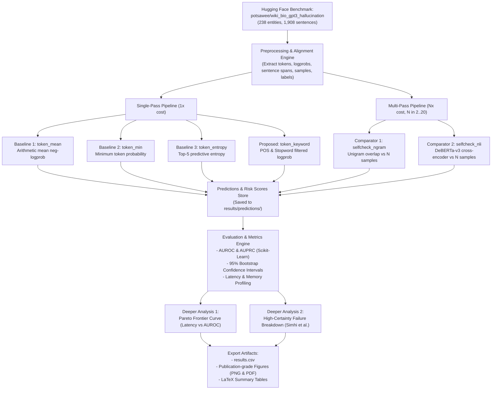

# Frozen Experiment Protocol & Blueprint (`experiment_protocol.md`)

**Study Title:** The Cost-Quality Pareto Frontier of Uncertainty Quantification in LLM Hallucination Detection  
**Protocol Status:** **FROZEN** (Established prior to baseline execution and results inspection)  
**Author / Lead:** Rajhans (PAI2026001, IIIT Allahabad)  
**Configuration File:** `configs/experiment.yaml`

---

## 1. Research Questions & Hypotheses

- **Primary RQ:** Across varying computational budgets (latency and forward passes), what is the empirical Pareto frontier between single-pass token uncertainty methods and multi-pass sampling consistency methods for sentence-level hallucination detection?
- **Subquestion RQ1 (Keyword Filtering):** Does isolating content/factual tokens by removing high-frequency syntactic stopwords narrow the AUROC performance gap between single-pass token UQ and multi-pass consistency?
  - *Hypothesis $H_1$:* Factual keyword filtering will increase single-pass AUROC by at least $+2.0\%$ over unweighted mean token log-probability by attenuating the surface-form bottleneck.
- **Subquestion RQ2 (High-Certainty Hallucinations):** In cases where the generative model outputs hallucinations with near-zero token uncertainty, can multi-pass sampling consistency recover the error?
  - *Hypothesis $H_2$:* Multi-pass consistency will retain detection sensitivity in $\ge 60\%$ of high-certainty token failure cases because stochastic sampling probes alternative parametric memory states.

---

## 2. Experimental Variables & Design

| Variable Type | Variable Name | Values / Definition |
| :--- | :--- | :--- |
| **Independent Variable 1** | Uncertainty Method Family | Single-Pass Token UQ vs. Multi-Pass Stochastic Consistency |
| **Independent Variable 2** | Method Variant | `token_mean`, `token_min`, `token_entropy`, `token_keyword`, `selfcheck_ngram`, `selfcheck_nli` |
| **Independent Variable 3** | Sample Budget ($N$) | $N=1$ (Single-pass), $N \in \{2, 3, 5, 10, 20\}$ (Multi-pass) |
| **Dependent Variable 1** | Discrimination Performance | Area Under ROC Curve (AUROC), Area Under Precision-Recall Curve (AUPRC) |
| **Dependent Variable 2** | Computational Latency | Wall-clock inference time per passage (milliseconds) |
| **Dependent Variable 3** | Generation Multiplier | Number of model forward passes required per passage ($1\times$ to $20\times$) |
| **Controlled Variables** | Test Instances & Context | Exact same 238 passages, identical 1,908 sentences, frozen human annotations, fixed hardware platform |

---

## 3. Complete Architecture Flowchart

---

## 4. Deeper Analyses Specifications

### Deeper Analysis 1: The Cost-Quality Pareto Frontier
- **Objective:** Plot empirical AUROC against wall-clock latency (ms/passage) and generation multiplier ($N$).
- **Success Criterion:** Identify the non-dominated Pareto frontier points and calculate the Marginal Cost of Quality:
  $$\Delta \text{Cost} / \Delta \text{AUROC} = \frac{\text{Latency}(M_B) - \text{Latency}(M_A)}{\text{AUROC}(M_B) - \text{AUROC}(M_A)}$$

### Deeper Analysis 2: High-Certainty Hallucination Error Analysis
- **Objective:** Isolate the subset of hallucinated sentences where token uncertainty completely fails ($S_{\text{mean}}(s) \le \text{median factual uncertainty}$, i.e., false negatives of token UQ).
- **Measurement:** Compute the recall of multi-sample consistency (`selfcheck_ngram`, `selfcheck_nli`) specifically on this high-certainty subset to evaluate whether stochastic consistency solves the failure mode described in Simhi et al. [9].

---

## 5. Statistical Rigor & Protocol Freezing

- **Random Seed:** Configured deterministically as `seed = 42`.
- **Confidence Intervals:** $95\%$ empirical confidence intervals computed via 1,000 bootstrap resamples on the test sentences.
- **Protocol Freezing Rule:** No hyperparameter tuning or post-hoc threshold adjustment is permitted after viewing test AUROC numbers.
